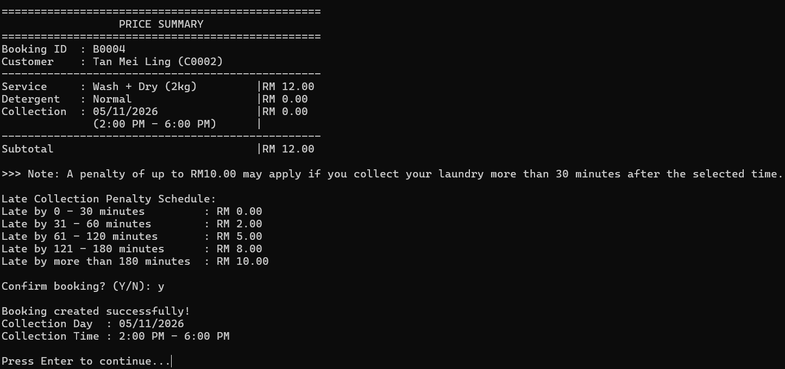
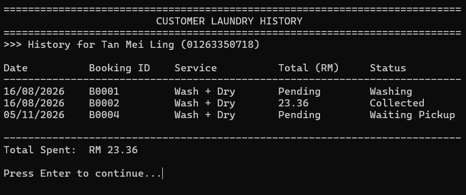

# C++ Laundry Management System

## 1. Project Overview

The **Laundry Management System** is a console-based application developed using C++ to manage laundry shop operations. The system aims to simplify laundry booking processes and customer record management.

This project was developed as a group assignment, where each team member was responsible for different system modules.

## 2. My Contributions

I was responsible for developing the following modules:

- **Laundry Booking** – Allows users to make laundry bookings and record booking details.
- **View Customer History** – Allows users to view previous customer records and laundry booking history.

## 3. Technologies & Concepts

- **Programming Language:** C++
- **IDE:** Microsoft Visual Studio
- **Programming Concepts:**
  - Object-Oriented Programming (OOP)
  - Functions
  - Arrays
  - Structures
  - File Handling (if applicable)

### 4. Prerequisites
- Microsoft Visual Studio
- C++ development tools

### 5. How to Run

1. Clone or download the repository.
2. Open the project in Microsoft Visual Studio.
3. Build the project.
4. Run the application.

## 6. Learning Outcomes

- Gained practical experience in C++ programming.
- Applied OOP concepts in developing a management system.
- Improved understanding of modular programming and code organisation.
- Developed experience working collaboratively on a group project.

## 7. Project Type

Group Academic Project

## 8. Developer Contributions

Developed the Laundry Booking and View Customer History modules as part of the group project.

## 9. Screenshots

### Laundry Booking

### Customer History

